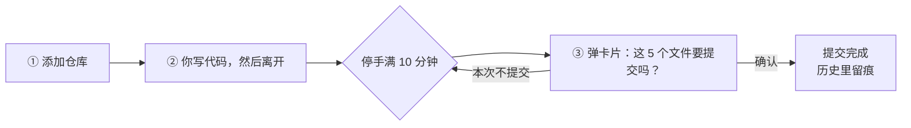
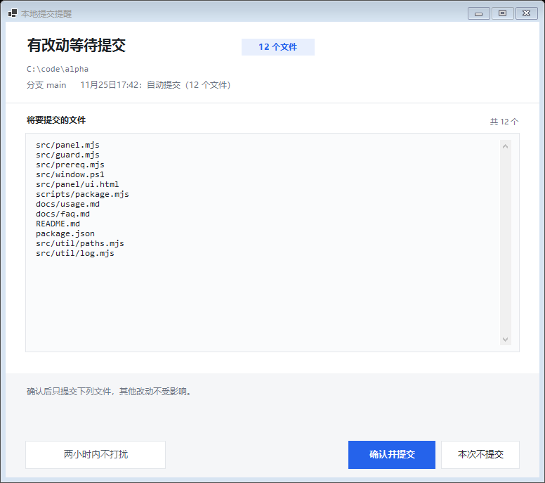
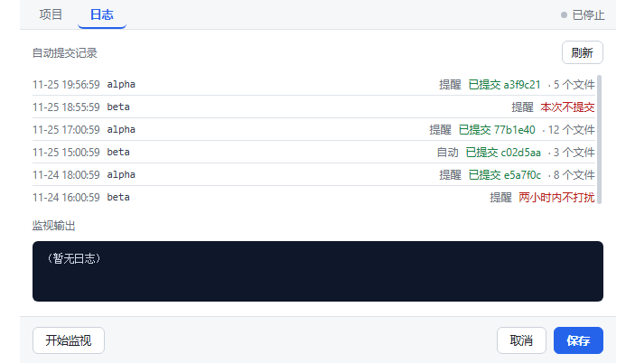

# Git-Protect · Git 静默提交助手

你专心写，它替你记得提交。

一个 Windows 托盘小工具：盯着你指定的几个 Git 仓库，**等你停手一段时间**，问你要不要提交；你确认，它就按你看到的文件清单提交。不想被打断时，也能让它直接提交、或者静默提交。


## 三十秒看懂





改了一下午，关机前才想起来没提交；或者连着提交三次，第四次忘了，第二天一个 `git checkout .` 抹掉一整天——这类事故不是不会用 Git，纯粹是**没人提醒**。这个工具就是那个提醒，仅此而已：它不改你的工作流，只在你已经停手的时候问一句。

## 它会留下什么痕迹

每次处理都记一行，包括「这次没提交」和「两小时内别打扰」：



左边是时间，中间是仓库，右边是结果：提交了就记下提交号和文件数，跳过了就写清为什么。回头查「昨天那批改动到底进没进历史」，看这一页就行。

## 三种模式

全局设置一次，对所有项目生效——用哪种模式是人的习惯，不是仓库的属性。

| 模式 | 停手后它会做什么 |
| --- | --- |
| **弹窗提醒**（默认） | 弹卡片列出这次会提交的文件，你点确认才提交 |
| **自动提交并通知** | 直接提交，再发一条 Windows 系统通知（收在托盘里也照发） |
| **完全静默提交** | 直接提交，只记在日志里，不打扰 |

不想提交时有两个按钮，分得很清楚：**本次不提交** = 这批改动先不动，文件一改就重新问你；**一段时间不打扰** = 这个仓库两小时内彻底不管，连自动模式也不提交。

## 它凭什么不乱提交

自动模式下没有人先看清单，所以完全靠内核的门禁。下面这些情况它**不会**提交，而是如实告诉你为什么：

- 版本对不上（弹窗期间文件又变了）、有未收尾的事务、事务门禁未清
- 游离 HEAD、正在 merge / rebase、子模块、skip-worktree
- 没配 git 身份
- 单次改动**超过 500 个文件**——自动降级成弹窗，免得一次吞掉几百个文件事后查不出来
- 仓库装了 `pre-commit` 这类钩子并返回失败（它不跳过钩子）

和「每天定时 `git add -A && git commit`」的区别也在这里：它只提交**你看到的那份清单**，走临时索引精确锁定路径，不是整仓 `add -A`；不改写历史、不 push、不切分支。

## 系统要求

| 依赖 | 用途 | 缺了会怎样 |
| --- | --- | --- |
| [Git for Windows](https://git-scm.com/download/win) | 所有提交都靠它 | 完全不能用 |
| [PowerShell 7](https://aka.ms/powershell)（`pwsh`） | 「弹窗提醒」的确认窗口是它画的 | 窗口永远不出现，而且不报错（Windows 自带的是 5.1，`pwsh` 要另装） |
| Git 提交身份（`user.name` / `user.email`） | `git commit` 的必要条件 | 提交必然失败 |

装完不等于能用，所以程序启动时会先自查这三项：缺哪项就把界面挡住，说明缺什么；Git 和 PowerShell 7 可以直接点按钮下安装包（下到你的下载文件夹，安装仍由你自己双击完成），装好点「重新检测」即可。

## 安装

到 [Releases](../../releases) 下载 **`GitQuietHelper-<版本>-setup.exe`**，双击，进度条走完就装好了。装到 `%LOCALAPPDATA%\Programs\GitQuietHelper`，不需要管理员权限。

未签名的 exe，SmartScreen 会拦一下：更多信息 → 仍要运行。没有买代码签名证书，这是唯一的代价。

卸载走「设置 → 应用」，或开始菜单里的卸载项；会问要不要一并删掉配置和提交记录。

## 使用

1. 打开窗口 →「添加项目」→ 选一个文件夹，它会把里面的 Git 仓库（含嵌套的）都列出来，勾选要监视的
2. 选模式，填「停手 N 分钟后处理」
3. 点「开始监视」。之后关窗口只是收进托盘，监视继续跑；真要退出请用托盘菜单

托盘菜单里还有「开机自启动」。

## 什么目录能加

| 你的情况 | 表现 |
| --- | --- |
| 正常仓库 | 直接用 |
| 刚 `git init`、还没有任何提交 | 能用，会做出第一次提交 |
| 填的是仓库里的子目录 | 拒绝，并告诉你要填哪个根目录 |
| 普通文件夹，还没建 Git | 拒绝，提示先在该目录 `git init` |
| 没配 git 用户名邮箱 | 添加时就提示，提交前也会拦住并给出要执行的命令 |
| 游离 HEAD / 正在 merge、rebase | 明确阻断，说明原因，不会假装提交成功 |

为什么不替你 `git init`：建仓库那一刻正是该决定 `.gitignore` 的时候，替你做很容易把 `node_modules`、构建产物甚至密钥一起提交进去。

`.gitignore`、`.git/info/exclude`、全局忽略都照常生效——它只提交 `git status` 里真的变了、且不在忽略范围内的文件。

## 隐私与联网

所有逻辑都在本地跑，**不登录、不上传、不统计**。唯一会联网的动作，是你在缺依赖时点「下载安装包」。配置和提交记录在 `%APPDATA%\git-quiet-helper\`，不写安装目录。

## 已知限制

- 只有 Windows；界面目前只有中文
- 打包后约 350 MB（Electron 运行时占绝大部分），安装器 155 MB
- 没代码签名，SmartScreen 会提示
- 只做本地提交，不推送远程

## 从源码跑

需要 Node.js 20+、Git、PowerShell 7。

```bash
npm install          # 只有 Electron 和打包工具，运行时零依赖
npm test             # 内核与界面回归，约 4 分钟
npm run app          # 直接起桌面窗口
npm run panel        # 或者只在浏览器里开配置面板 http://127.0.0.1:7331/
```

打包（国内建议设 `ELECTRON_MIRROR`，否则下 Electron 会很慢）：

```bash
$env:ELECTRON_MIRROR='https://npmmirror.com/mirrors/electron/'
npm run package      # dist/GitQuietHelper-win32-x64/
npm run installer    # dist/GitQuietHelper-<版本>-win64.zip
npm run setup        # dist/GitQuietHelper-<版本>-setup.exe（单文件安装器）
```

## 许可

[MIT](LICENSE)。
