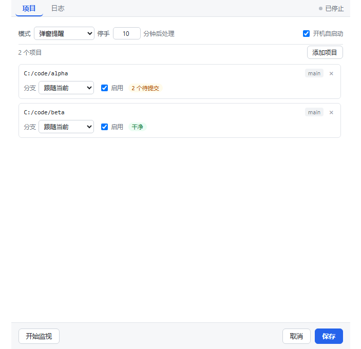

# Git-Protect · Git 静默提交助手

你专心写，它替你记得提交。

一个 Windows 托盘小工具：盯着你指定的几个 Git 仓库，**等你停手一段时间后**，提醒你提交，或者干脆自己提交掉。装一次，之后忘掉它就行。



## 它解决什么问题

改了一下午代码，最后关机前才想起来没提交；或者提交了三次，第四次忘了，第二天用 `git checkout .` 把一整天抹掉——这类事故不是不会用 Git，纯粹是**没人提醒**。

这个小工具就是那个提醒。它不接管你的 Git 习惯，只在你已经停手的时候问一句：「这些改动要提交吗？」

## 三种模式

全局设置一次，对所有项目生效。用哪种是人的习惯，不是仓库的属性。

| 模式 | 停手后它会做什么 |
| --- | --- |
| **弹窗提醒**（默认） | 弹一张卡片，列出这次会提交的文件，你点确认才提交 |
| **自动提交并通知** | 直接提交，再发一条 Windows 系统通知（窗口收进托盘也照发） |
| **完全静默提交** | 直接提交，只记一笔到日志，不打扰 |


窗口上的三个按钮是刻意的——「这次先不动」和「这两个小时都别烦我」是两种完全不同的诉求：

| 按钮 | 含义 | 之后会怎样 |
| --- | --- | --- |
| 确认并提交 | 就按清单提交 | — |
| 本次不提交 | 这批改动这次先不动 | 文件内容一变就重新问你；同一批改动不重复弹 |
| 一段时间不打扰 | 这个仓库先别管 | 默认 2 小时内完全不处理它，**自动模式也不提交** |

第三种连自动模式也停，是因为你点的是「别烦我」。如果后台照旧提交，这个按钮就是骗人的。

## 系统要求

**装完不等于能用。** 下面三项齐了才会工作；缺哪项，程序启动时会把界面挡住，逐项说清楚缺什么。

| 依赖 | 用途 | 缺了会怎样 |
| --- | --- | --- |
| [Git for Windows](https://git-scm.com/download/win)（在 PATH 里） | 所有提交都靠它 | 完全不能用 |
| [PowerShell 7](https://aka.ms/powershell)（`pwsh`） | 「弹窗提醒」模式的确认窗口是它画的 | 窗口永远不出现，而且不报错（Windows 自带的是 5.1，`pwsh` 要另装） |
| Git 提交身份（`user.name` / `user.email`） | `git commit` 的必要条件 | 提交必然失败 |

缺前两项时，界面里有「下载安装包」按钮：工具会去取最新安装器（Git 64 位 exe；PowerShell 取最新一个**带 MSI** 的稳定版，因为最新版有时只发 zip），下到 `%USERPROFILE%\Downloads\GitQuietHelper-依赖\` 并打开该文件夹，**安装仍由你自己双击完成**。GitHub 连不上时会自动改用国内镜像。

## 安装

到 [Releases](../../releases) 下载 **`GitQuietHelper-<版本>-setup.exe`**，双击，等进度条走完就行——装完自动启动，不需要解压、不需要管理员权限。

（Release 里的 `Source code.zip` 是 GitHub 自动生成的仓库快照，不是安装包，别下那个。）

也可以下载 `GitQuietHelper-<版本>-win64.zip` 手动装：解压后双击 `安装.cmd`。两种方式装出来的东西完全一样，zip 那份适合想先看看文件构成、或要放到内网分发的人。

- 装到 `%LOCALAPPDATA%\Programs\GitQuietHelper`，**不需要管理员权限**
- 建开始菜单和桌面快捷方式，在「应用和功能」里登记卸载项
- 卸载走 `卸载.cmd` 或系统设置，会问要不要一并删掉配置和提交记录
- 安装脚本优先用 PowerShell 7，没有就退回系统自带的 5.1，所以**没装 pwsh 也能装完**，装完程序会提示你补

没有签名的 exe，第一次运行 Windows SmartScreen 会拦一下：点「更多信息」→「仍要运行」。想彻底不提示只能买代码签名证书，这个项目没有买。

## 使用

1. 打开窗口，点「添加项目」，选一个文件夹——它会把这个文件夹下的 Git 仓库（含嵌套的）都扫出来，勾选要监视的
2. 选个模式，填「停手 N 分钟后处理」
3. 点「开始监视」。之后关闭窗口只是收进托盘，监视继续跑；要退出请用托盘菜单

托盘菜单里还有「开机自启动」。提交记录、失败原因都在「日志」标签里。

## 它凭什么不乱提交

自动模式没有人先看清单，所以完全靠内核的门禁。下面这些情况它**不会**提交，而是如实告诉你为什么：

- 版本对不上（弹窗期间文件又变了）、有未收尾的事务、事务门禁未清
- 游离 HEAD、正在 merge / rebase、有未结束的运行标记
- 没配 git 身份
- 单次改动**超过 500 个文件**——一次吞掉几百个文件的提交事后很难查，所以自动降级成弹窗
- 仓库装了 `pre-commit` 之类的 hook 并返回失败（它不跳过 hook）

它也不会改写历史、不会 force push、不会替你执行 `git init`。

## 什么目录能加

| 你的情况 | 表现 |
| --- | --- |
| 正常仓库 | 直接用 |
| 刚 `git init`、还没有任何提交 | 能用，会做出第一次提交 |
| 填的是仓库里的子目录 | 拒绝，并告诉你要填哪个根目录 |
| 普通文件夹，还没建 Git | 拒绝，提示先在该目录 `git init` |
| 没配 git 用户名邮箱 | 添加时就提示，提交前也会拦住并给出要执行的命令 |
| 游离 HEAD / 正在 merge、rebase | 明确阻断，说明原因，不会假装提交成功 |

为什么不替你 `git init`：建仓库那一刻正是该决定 `.gitignore` 的时候，替你做很容易把 `node_modules`、构建产物甚至密钥一起提交进去。

`.gitignore`、`.git/info/exclude`、全局忽略都照常生效——工具只提交 `git status` 里真的变了、且不在忽略范围内的文件。

## 隐私与联网

- 所有逻辑都在本地跑，**不登录、不上传、不统计**
- 唯一会联网的动作是你在缺依赖时点「下载安装包」，去 GitHub（或国内镜像）取安装器
- 配置和提交记录都在 `%APPDATA%\git-quiet-helper\`，不写安装目录

## 已知限制

- 只有 Windows
- 界面是中文，暂时没有英文版
- 打包后约 350 MB（Electron 运行时占绝大部分）
- 没签名，SmartScreen 会提示

## 从源码跑

需要 Node.js 20+、Git、PowerShell 7。

```bash
npm install          # 只有 Electron 和打包工具，运行时零依赖
npm test             # 内核与界面回归，约 4 分钟
npm run app          # 直接起桌面窗口
npm run panel        # 或者只在浏览器里开配置面板 http://127.0.0.1:7331/
```

打包（国内建议设 `ELECTRON_MIRROR`，否则下 Electron 会很慢）：

```bash
$env:ELECTRON_MIRROR='https://npmmirror.com/mirrors/electron/'
npm run package      # dist/GitQuietHelper-win32-x64/
npm run installer    # dist/GitQuietHelper-<版本>-win64.zip
npm run setup        # dist/GitQuietHelper-<版本>-setup.exe（单文件安装器）
```

## 许可

[MIT](LICENSE)。
